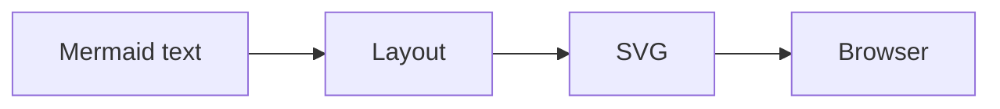
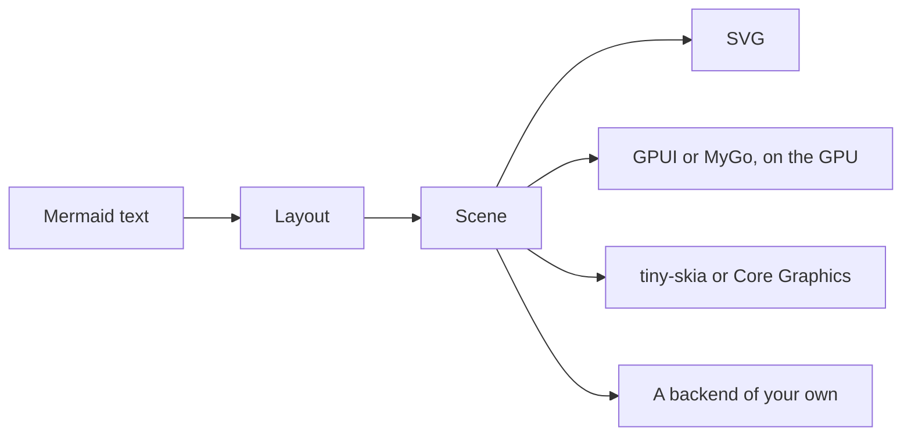

This page summarizes the design of limu-rs and limu for people who use them. The full design documents, [limu-rs's](https://github.com/firede/limu-rs/blob/main/docs/design.md) and [limu's](https://github.com/firede/limu/blob/main/docs/design.md), are written for people who work on them.

limu-rs and limu are two ports of the same renderer, [Pele](https://pele.run), one in Rust and one in Go. They lay a diagram out the same way, to the last bit of every number, and differ in how a program calls them and in the backends that come with them.

## Where the pipeline branches

Mermaid and Pele lay out a diagram and write it as SVG for a browser to draw.

limu stops one step earlier, at the scene, and the pipeline branches there to different backends.

With an SVG renderer, the SVG is all an app gets, and an app that doesn't draw SVG, such as a native app, has nothing to work with. A scene is the laid-out diagram as data, before anything is drawn. An app can draw it with whatever tools it has, and can ask it what is where.

## The stages

A diagram passes through three stages.

1. **Parsing** reads the text into a model. It handles front matter and directives, detects the type, and hands the body to that type's parser.
2. **Layout** places the model's parts and produces a scene, measuring text with the measurer you provide. The scene records what each part is and where it goes, but not how it looks.
3. **A backend** draws the scene and picks its colors from a look.

In Rust, parsing and layout are one crate, and what a backend needs is another, so a backend never builds the parsers. Each backend that needs a library of its own is a crate of its own.

| Crate | What it does |
| --- | --- |
| `limu` | Parses a diagram and lays it out, with a feature for each diagram type. It also holds the layout options and the names of the roles. |
| `limu-scene` | Describes a laid-out diagram, its text and its style, and holds the drawing every backend shares and the SVG backend. `limu` gives it as `limu::scene`. |
| `limu-tiny-skia` | Draws a scene into a bitmap with tiny-skia. |
| `limu-coregraphics` | Draws a scene with Core Graphics, on Apple's platforms. |
| `limu-gpui` | Draws a scene in a GPUI window. |
| `limu-ascii` | Draws a scene in a terminal's cells, with box-drawing characters or ASCII alone. |

`limu` and `limu-scene` use only Rust's standard library, and `serde` behind their optional `serde` feature.

In Go, each stage has its own package. The svg package writes SVG, and limumygo draws with MyGo.

| Package | What it does |
| --- | --- |
| `limu` | Parses a diagram and lays it out. |
| `diagram` | Reads the front matter, directives and type that every diagram shares. Each type has a package under it that parses and lays out that type. |
| `text` | Measures text with the measurer you provide, and lays out labels with line breaks, wrapping, emphasis and icons. |
| `layout` | Holds the layout options. |
| `scene` | Describes a laid-out diagram. |
| `style` | Holds themes and per-role overrides. |
| `svg` | Renders a scene as SVG. |
| `limumygo` | Draws a scene with MyGo. It's a separate module. |

Every package except limumygo uses only Go's standard library.

## Layout and style

Anything that changes where things go or how big they are belongs to layout, and changing it means laying the diagram out again. That covers the measurer and its fonts, text size, available width, padding, snapping to a grid, edge routing, and the current date for gantt charts. Everything else is style, which is applied only when the scene is drawn, so changing it only redraws.

That's why a scene holds no colors. Each part refers to colors by token, such as the surface or the border, and says what it is by its role, such as `flowchart.node`. The backend looks up the actual colors in the theme and the overrides for each role. The same scene can be drawn in a light theme, a dark theme, or an app's own look without being laid out again. See [Theming](/theming).

The last picture keeps the scene's geometry and replaces only the drawing. Its nodes and edge labels are panes of MyGo's Liquid Glass, which bend what lies under them at the rim. That's hard to do with SVG in a browser. The program that draws these pictures is [limumygo/examples/pictures](https://github.com/firede/limu/tree/main/limumygo/examples/pictures).

A backend can go further and lay the diagram out again for a look of its own. [mygo-platinum](https://github.com/firede/mygo-platinum) draws Mermaid in the Platinum look of late-1990s desktops. It measures text in its own bitmap faces, so the boxes take other sizes, and it draws every line and arrowhead a pixel at a time. Its [examples/diagrams](https://github.com/firede/mygo-platinum/tree/main/examples/diagrams) drew this picture.

limu-rs's terminal backend does the same with a terminal's cells. It measures every character as a cell, snaps the scene to the grid of cells, and draws its lines with box-drawing characters. See [Terminal](/terminal).

## Writing a backend

In Rust, the backends share one drawing. A backend implements `limu::scene::Canvas`, which fills and strokes paths, sets runs of text and draws pictures, and `limu::scene::draw` walks the scene's items in order. For each item, it resolves the colors from the look, then hands the canvas the item's parts, the markers at an edge's ends, its picture, and its label, split into runs of one face each. A backend's hook can draw any item another way, from its role, shape, bounds and route, and use the painter for the rest. The SVG backend is a canvas in under 600 lines, and the [API](/api#the-scene) page describes what an item holds.

A backend walks the scene's items in order and draws each one. It fills and strokes the item's `Parts` as their `Paint` says, using the colors the look resolves for the item (`style.Look.Resolve`). It then draws the markers at an edge's ends (`Marker.Outline`), the item's picture, and its label, setting each span of each line in its face around `At`. A backend with its own look can instead draw items from their `Role`, `Shape`, `Box` and `Route`. The svg package is a complete backend in about 700 lines, and the [API](/api#the-scene) page describes what an item holds.

## Ported from Pele

Most of limu is ported function by function from [Pele](https://pele.run), the Mermaid renderer made by the Obsidian team. The ports keep Pele's names, in Rust's case and in Go's, so each codebase can be read side by side with Pele. limu-rs is ported from Pele too, not from limu. Both follow Pele 1.12.0.

Their tests check their output against Pele's, number for number. A tool called the oracle runs Pele's TypeScript source with Node over more than a hundred thousand diagrams, taken from Pele's tests and documentation and from variations of them, and saves Pele's output as fixtures. limu's oracle is part of limu. limu-rs downloads its fixtures from the releases of [pele-oracle](https://github.com/firede/pele-oracle), which grew out of limu's. The tests compare against those fixtures, and even a difference in the last bit of a number counts as a bug in the port. The tests run on both amd64 and arm64.

To match Pele to the last bit, the ports keep JavaScript's behavior wherever it affects measuring or placement. Strings are counted in UTF-16 code units, white space and letter case follow JavaScript, `Math.round` rounds halves the same way, and trigonometry and JSON parsing follow V8. Products are kept separate from the sums they appear in, as JavaScript keeps them. Go would otherwise fuse them into a single rounding on arm64, while Rust never does unless asked. Text is measured the way Pele measures it without fonts, from a table of Arial's character widths.

Matching Pele is how the ports are verified, not the goal in itself. Where Mermaid hands a diagram to an outside library, Pele often uses a layout of its own, and limu follows Pele. See [Compatibility](/compatibility).

limu-rs keeps limu's words for things unless there's a reason to change them. Where it's built otherwise, its design document lists each change and the reason for it. Most of the changes are in the scene and the backends. A few reach a program, such as swimlane diagrams having roles of their own and gantt charts reading dates in UTC unless the program gives another time zone.
