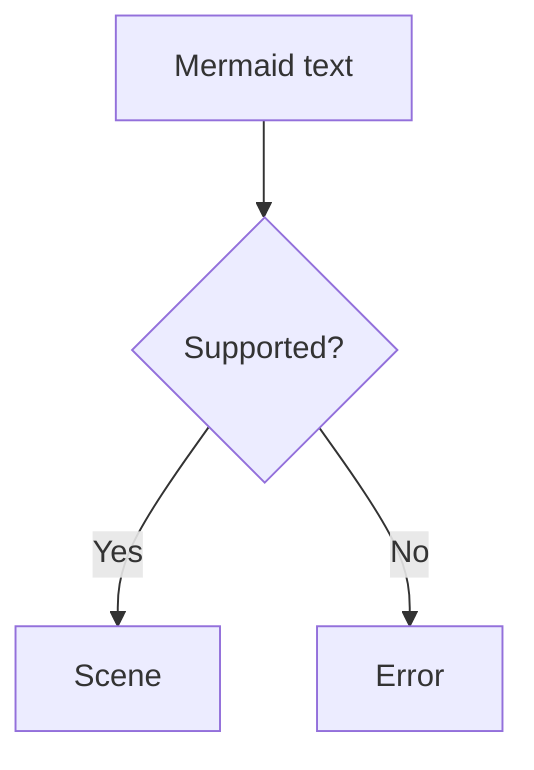

The limu-ascii crate draws limu's scenes as text, in a grid of cells the size of a terminal's. Lines are drawn in Unicode's box-drawing characters, or in ASCII for terminals that have no more. Use it to show a diagram in a command-line tool, in a terminal UI, or anywhere else a diagram has to be plain text.

limu-rs is not released yet, and its API may change before 0.1.

## Installing

limu-ascii is a crate of its own, which keeps limu and limu-scene free of anything beyond Rust's standard library. It depends on unicode-width, to count the cells a character takes. limu-rs isn't on crates.io yet, so add both crates from its repository.

```shell
cargo add limu --git https://github.com/firede/limu-rs
cargo add limu-ascii --git https://github.com/firede/limu-rs
```

## Drawing a diagram as text

A diagram is laid out for cells and then drawn in them. `limu_ascii::render` returns the text, a line for each row of cells, with no spaces at the ends of lines.

```rust
use limu_ascii::{Cells, Options};

let cells = Cells::default();
let layout = limu::layout::Options {
    measurer: &cells,
    font_size: cells.font_size(),
    snap: Some(cells.grid()),
    max_width: 80.0 * cells.width,
    direction_breakpoint: f64::INFINITY,
    ..Default::default()
};
let scene = limu::layout(src, &layout)?;
print!("{}", limu_ascii::render(&scene, &Options::default())?);
```

Given this flowchart, it prints the text below.



```text
      ╭──────────────╮
      │ Mermaid text │
      ╰───────┬──────╯
              │
       ┌──────▼─────┐
       < Supported? >
       └────┬──┬────┘
     ┌──────┘  └───────┐
     │                 │
    Yes               No
     │                 │
╭────▼──╮         ╭────▼──╮
│ Scene │         │ Error │
╰───────╯         ╰───────╯
```

The [Rust playground](/playground/rust) can show any diagram this way, as text for a terminal.

## Laying out for cells

Layout has nothing of its own for cells. Four of its options lay a diagram out for them.

- `measurer` is a `Cells`, which measures text by the cells it takes in a terminal. Every character takes a cell's width, whatever its size and face.
- `font_size` is `cells.font_size()`, the size whose lines are a row high. A line is 1.5 times as high as its text, so the size is two thirds of a row.
- `snap` is `cells.grid()`, so that every point of the scene falls on the grid of cells.
- `max_width` is the terminal's width, the number of columns times `cells.width`. With `direction_breakpoint` set to infinity, a diagram that runs across turns to run down whenever that is narrower and it doesn't fit.

A `Cells` is 6 units wide and 12 high by default, half as wide as high, as a terminal's cells about are. Text is then laid out at a size of 8. The room limu leaves about text and between the parts of a shape is given in pixels and doesn't scale with the text, so in cells it comes to about a row. Give `Options.cells` the same cells the scene was laid out for.

Given 30 columns, the flowchart `text[Mermaid text] --> layout[Layout] --> scene[Scene]`, written to run left to right, turns to run down. Given 80, it runs across, as it does under [Characters](#characters).

```text
╭──────────────╮
│ Mermaid text │
╰───────┬──────╯
        │
   ╭────▼───╮
   │ Layout │
   ╰────┬───╯
        │
    ╭───▼───╮
    │ Scene │
    ╰───────╯
```

A diagram is as wide as its layout makes it. Most diagrams fit the width they're given, but some can't be drawn narrower, and nothing is cut off or wrapped to fit.

## Characters

`Options.charset` picks the characters lines are drawn in. `Charset::Unicode`, the default, draws in box-drawing characters and Unicode's arrows. Where lines meet in a cell, they're joined in one character, such as "┬" or "┼". `Charset::Ascii` draws in "-", "|", "+" and letters for arrows, for terminals and fonts that have nothing more.

```rust
use limu_ascii::{Charset, Options};

let o = Options {
    charset: Charset::Ascii,
    ..Options::default()
};
```

The flowchart that runs across, in ASCII, looks like this.

```text
+--------------+ +--------+ +-------+
| Mermaid text +-> Layout +-> Scene |
+--------------+ +--------+ +-------+
```

## Compact drawing

limu leaves room between things for a diagram drawn in pixels. In cells that room is several rows and columns, where diagrams drawn as text usually leave one. So limu-ascii cuts it after drawing, as `Options.compact` asks by default. Each run of rows that nothing but straight lines down passes through, and each run of columns that nothing but straight lines across passes through, is cut to one. Lines that only pass through such a row or column grow shorter, so nothing comes apart. The empty rows and columns about the diagram are cut away. Then each node's box is drawn in about its text, its top and bottom next to the text and its sides a cell from it. Block diagrams and treemaps keep their boxes as they are, because their sizes are columns and values.

With `compact: false` in `Options`, every cell is where the scene puts it, as in the flowchart below.

```text
 ╭─────────────────╮       ╭───────────╮       ╭──────────╮
 │  Mermaid text   ├───────▶  Layout   ├───────▶  Scene   │
 │                 │       │           │       │          │
 ╰─────────────────╯       ╰───────────╯       ╰──────────╯
```

## Diagrams it doesn't draw

Some diagrams say what they say in where things are and how large they are, finer than a cell can show. These are pie charts, XY charts, radar charts, Sankey diagrams, Gantt charts and packet diagrams. In git graphs and tree views, the lines are too close together for cells to tell apart. Drawn in cells, these 8 types would mislead, and a drawing that misleads is worse than none. So `render` returns an `Unsupported` error for them rather than draw them. Its `diagram` field holds the type's name, and it reads as "a pie diagram can't be drawn as text". limu-ascii doesn't write them in forms of its own, such as tables or lists, because a backend draws the scene it's given and nothing else.

`limu_ascii::supports` says whether a type can be drawn, by the name its scene gives it, which is the name of its type in limu. To ask before laying a diagram out, parse it first.

```rust
let diagram = limu::parse(src, &limu::ParseOptions::default())?;
if limu_ascii::supports(diagram.diagram_type().name()) {
    let scene = diagram.layout(&layout)?;
    print!("{}", limu_ascii::render(&scene, &limu_ascii::Options::default())?);
} else {
    // Draw it another way, or say it can't be shown here.
}
```

## Chinese, Japanese and Korean

`Cells` counts the cells each character takes as a terminal does. A character of East Asian scripts takes two cells, a combining accent takes none, and characters whose width depends on the terminal's locale take one. Layout leaves room for text by these counts, so wide text fits its box.

```text
╭──────╮ ╭──────╮ ╭──────╮
│ 开始 ├─▶ 检查 ├─▶ 完成 │
╰──────╯ ╰──────╯ ╰──────╯
```

Box-drawing characters and arrows are among those whose width depends on the locale. A terminal that sets them two cells wide, as some do in East Asian locales, pulls the drawing apart, so draw in ASCII there.

## What cells can't show

A grid of cells has no colors, fills or images, so limu-ascii takes no look, fonts, icons or images. A fill only hides what it covers, and only where it can't be seen through. A Venn diagram's sets are filled so that their overlaps show, and their outlines show through each other. A picture in a node, such as an icon, is left out.

An edge is drawn in lines across and down, as trees are drawn in text, because steps that follow a curve cell by cell are hard to follow. A node whose outline curves or slants, such as a stadium or a diamond, is drawn as the box it lies in, with rounded corners where it curves and pointed sides where it comes to a point. A shape too small to outline in cells is drawn as a dot, or as an arrowhead where it's a triangle, and a marker as an arrow or a mark like it. The ends of an entity relationship are written as how many each side has, such as "0..*", because a crow's foot in a cell looks like an arrow.

Labels are set last, a line to a row, and every line of every label is set whole. Text may break lines down but never lines across or other text. It moves a row for room, and where there is none, a row is put in for it. A label turned 30 degrees or more, such as an axis title, is set across.
