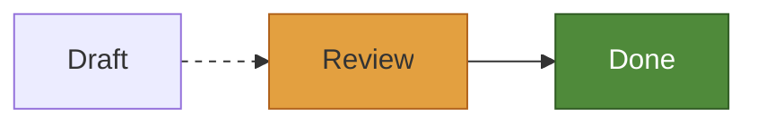

A scene holds no colors. Each part refers to colors by token, such as the surface or the border, and the backend resolves them when it draws. Changing the style therefore redraws a diagram without laying it out again.

You can control the style at three levels, each giving you more control than the last.

1. A **theme** sets the handful of colors and measures that every diagram is drawn from.
2. **Overrides** change the style of one role, such as `flowchart.node`, on top of the theme.
3. **Custom drawing** replaces how the backend draws a part.

The first two make up a look, `rust:limu::scene::style::Look` `go:style.Look`, which you pass to a backend.

```rust
use limu::roles::flowchart;
use limu::scene::style::{Look, Paint, Style, Theme};
use limu::scene::svg;

let mut look = Look::new(Theme::KOHU_DARK);
look.overrides.insert(
    flowchart::NODE.into(),
    Style { fill: Some(Paint::ACCENT), text: Some(Paint::BG), ..Default::default() },
);
look.overrides.insert(
    flowchart::EDGE.into(),
    Style { dash: Some(vec![3.0, 4.0]), ..Default::default() },
);
let out = svg::render(&scene, &svg::Options { look, ..Default::default() });
```

```go
look := style.Look{
	Theme: style.KohuDark(),
	Overrides: style.Overrides{
		"flowchart.node": {Fill: style.Accent, Text: style.Bg},
		"flowchart.edge": {Dash: style.Dashes(3, 4)},
	},
}
out := svg.Render(sc, &svg.Options{Look: look})
```

Fonts and text sizes change where things go, so they belong to [layout](/api#layout) rather than style.

## Themes

limu comes with three themes. Kohu and Kohu dark, `rust:Theme::KOHU` `rust:Theme::KOHU_DARK` `go:style.Kohu()` `go:style.KohuDark()`, are limu's own light and dark themes, in this site's colors. Pele's light theme, `rust:Theme::PELE` `go:style.Default()`, is what a look without a theme uses.

| Token | Used for | Kohu | Kohu dark | Pele |
| --- | --- | --- | --- | --- |
| `rust:bg` `go:Bg` | The background, also behind labels on lines | `#f1f6f5` | `#0c1618` | `#ffffff` |
| `rust:fg` `go:Fg` | Text | `#0f262a` | `#d0dddc` | `#1f1f1f` |
| `rust:muted` `go:Muted` | Secondary text, such as group titles | `#536f72` | `#7f989b` | `#6e6e6e` |
| `rust:line` `go:Line` | Edges and other lines | `#23393d` | `#b4c7c7` | `#1f1f1f` |
| `rust:surface` `go:Surface` | The inside of shapes | `#e5eeec` | `#142428` | `#f3f3f3` |
| `rust:surface_alt` `go:SurfaceAlt` | The inside of groups and of highlighted shapes | `#d6e4e2` | `#1b2f34` | `#e6e6e6` |
| `rust:border` `go:Border` | Shape outlines | `#76939a` | `#557176` | `#8a8a8a` |
| `rust:accent` `go:Accent` | Parts a diagram highlights | `#a92e4a` | `#ee8494` | `#5b7bd5` |
| `rust:critical` `go:Critical` | Parts a diagram marks as critical, such as critical gantt tasks | `#b0611a` | `#e3a040` | `#e45756` |

Each theme also has eight series colors. Charts use them for slices, bars and lines, and git graphs and mindmaps use them for branches. A diagram with more than eight series starts over from the first. In code, `rust:Paint::series(0)` `go:style.Series(0)` is the first series color.

| Series | Kohu | Kohu dark | Pele |
| --- | --- | --- | --- |
| 1 | `#4f8a3a` | `#8cbf6a` | `#4c78a8` |
| 2 | `#b5435c` | `#e37d90` | `#f58518` |
| 3 | `#23817d` | `#5cbcb3` | `#54a24b` |
| 4 | `#a8761c` | `#d9a748` | `#e45756` |
| 5 | `#3d6aa3` | `#78a3d9` | `#72b7b2` |
| 6 | `#7b5aa0` | `#ad92d1` | `#eeca3b` |
| 7 | `#c0668a` | `#e693b3` | `#b279a2` |
| 8 | `#7d6a3f` | `#b9a272` | `#9d755d` |

All three themes use a corner radius of 4 (`rust:radius` `go:Radius`) and a line width of 1 (`rust:stroke_width` `go:StrokeWidth`).

To make your own theme, fill in every color of a theme. To change only a few colors, copy an existing theme first.

```rust
use limu::scene::style::{Color, Look, Theme};

let mut theme = Theme::KOHU;
theme.accent = Color::hex("#3d6aa3");
let look = Look::new(theme);
```

```go
th := *style.Kohu()
th.Accent = style.Hex("#3d6aa3")
look := style.Look{Theme: &th}
```

The SVG backend writes theme colors as CSS variables, so a page can switch them, for example between its light and dark themes, without rendering the diagram again. See [SVG](/svg#theme-variables).

## Overrides

The overrides map a role to a style, `rust:limu::scene::style::Style` `go:style.Style`. Anything the style leaves unset falls through to the level below.

| Field | What it sets |
| --- | --- |
| `rust:fill, stroke, text` `go:Fill, Stroke, Text` | The paint for the inside, for outlines and lines, and for text. |
| `rust:fill_opacity, stroke_opacity, opacity` `go:FillOpacity, StrokeOpacity, Opacity` | The opacity of the fill, of the stroke, and of the whole part. |
| `rust:stroke_width` `go:StrokeWidth` | The width of outlines and lines. |
| `rust:radius` `go:Radius` | The corner radius of boxes that use the theme's radius. |
| `rust:dash` `go:Dash` | The dash pattern of a line, such as `rust:vec![3.0, 4.0]` `go:style.Dashes(3, 4)`, or a solid line, `rust:vec![]` `go:style.Solid`. |
| `rust:cap, join` `go:Cap, Join` | How lines end and turn corners, like SVG's `stroke-linecap` and `stroke-linejoin`. |
| `rust:halo, halo_width` `go:Halo, HaloWidth` | A halo around text that keeps lines underneath from running into it. |

A paint can be a theme color such as `rust:Paint::SURFACE` `go:style.Surface`, `rust:Paint::ACCENT` `go:style.Accent` or `rust:Paint::series(2)` `go:style.Series(2)`, a color of its own such as `rust:Paint::own(Color::hex("#3d6aa3"))` `go:style.Of(style.Hex("#3d6aa3"))`, or `rust:Paint::NONE` `go:style.None` to draw nothing. `rust:Paint::with_opacity` `go:Paint.Alpha` makes a paint partly transparent. In Go, set measures with `style.N`, as in `StrokeWidth: style.N(2)`. In Rust, every field is an `Option`, as in `stroke_width: Some(2.0)`.

Styles cascade in this order, from lowest to highest priority. The theme's measures come first, then the diagram's own style for the part, then your overrides for its role, and finally whatever the diagram's author wrote in the text.

### Roles

A role is the diagram's name and the part's name joined by a dot, such as `flowchart.node`, `sequence.actor` or `pie.slice`. Every role has a constant, such as `rust:limu::roles::flowchart::NODE` `go:flowchart.RoleNode`, and the SVG backend writes the role into the class name, as in `limu-flowchart-node`. In the [playground](/playground), the status bar shows the role of whatever is under the pointer.

In Rust, swimlane diagrams have roles of their own, such as `swimlane.node`, so a program can style them apart from flowcharts. In Go, they reuse the flowchart roles, so an override for `flowchart.node` applies to them too.

## Custom drawing

Each backend accepts a function that draws an item in place of the default. In Rust, the function receives the backend's painter, whose `item` draws the item the default way. In Go, it receives `next`, which does the same. Either way it can leave most items alone. It can also draw the default pieces one by one, which are the outline, the markers, the picture and the label. This example draws a flowchart's decision diamonds differently and keeps the default label.

```rust
let o = svg::Options { look, ..Default::default() };
let out = svg::render_with(&scene, &o, |p, it, s| {
    if it.shape.as_ref().map(|shape| shape.as_str()) != Some("diam") {
        p.item(it, s);
        return;
    }
    // Write the diamond's markup with p.canvas().raw, in the item's bounds.
    p.label(it, s);
});
```

```go
out := svg.Render(sc, &svg.Options{
	Look: look,
	Draw: func(w *svg.Writer, it *scene.Item, s style.Style, next func()) {
		if it.Shape != "diam" {
			next()
			return
		}
		// Write the diamond's markup with w.Raw, in the item's Box.
		w.Label(it, s)
	},
})
```

A backend with a look of its own can draw every item from its role, shape, box and, for edges, route, and ignore the outline in the scene. Each backend draws with its own tools, so the function's signature differs between them. See [SVG](/svg#custom-drawing), and the page of each native backend.

## Styles in the diagram

A diagram's author can style parts in the text itself with `classDef`, `class`, `:::` and `style`, and can style flowchart edges with `linkStyle`.



limu reads `fill`, `stroke`, `color`, the opacities, `stroke-width`, `stroke-dasharray`, `stroke-linecap`, `stroke-linejoin`, `rx` and `ry`. It also reads the font's weight, style and size, which change the size of text and so go to layout. It ignores other properties, and any value that could reach outside the diagram.

The author's styles sit above your overrides. Their colors are fixed and don't change with the theme.

When the author fills a part and sets no color for its text, the text is drawn in the theme's foreground or background, whichever stands out more against the fill, as Pele does. The same goes for edges and labels that lie inside a group the author fills, such as a subgraph, a block or a sequence diagram's box. An edge that crosses the border of such a fill is drawn over a casing in the background's color, so it stays visible where it runs over the fill. A casing is an item with a role of its own, such as `block.casing`. A group that a diagram draws translucent, such as a block diagram's composite block, is drawn opaque when the author fills it.
