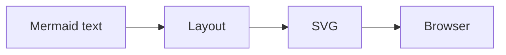
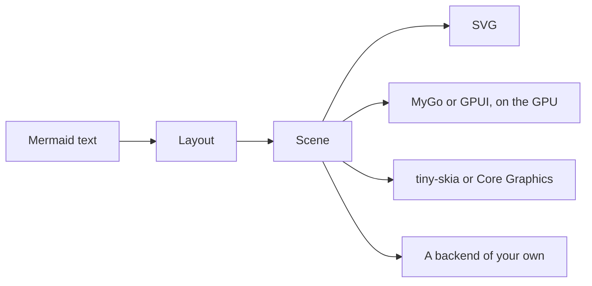

limu is a diagram layout engine in Go and Rust. It reads Mermaid and leaves the drawing to your program.

## How it works

Mermaid and Pele lay out a diagram and write it as SVG for a browser to draw.



limu stops one step earlier, at the scene. A scene is the laid-out diagram as data. It says what each part is and where it goes, but not how it looks. A backend then draws it, whether that is MyGo or GPUI on the GPU, tiny-skia or Core Graphics into a bitmap, a terminal's cells, SVG, or one you write.



Because the scene holds no colors, it's laid out once and can be drawn any number of ways. Switching themes only redraws it, and a backend can also draw each part its own way.


An app can also ask the scene which part is under the pointer.

## limu in your app

### Go

#### MyGo

```shell
go get github.com/firede/limu/limumygo
```

limumygo draws a scene on the GPU with MyGo's native UI and tells you which part is under the pointer. Lay out the diagram with the same fonts you draw it in.

```go
fonts := limumygo.DefaultFonts
sc, err := limu.Layout(src, &layout.Options{Measurer: fonts})
if err != nil {
	return err
}

// Draw the diagram in a view, and see which part was clicked.
w := limumygo.View(c, sc, &limumygo.Options{
	Look:  style.Look{Theme: style.KohuDark()},
	Fonts: fonts,
})
if it := w.Clicked(); it != nil {
	fmt.Println("clicked", it.Role, it.ID)
}
```

#### SVG

```shell
go get github.com/firede/limu
```

The svg package writes a scene as SVG and leaves its colors as CSS variables, so a page can restyle it. limu and the svg package use only Go's standard library.

```go
sc, err := limu.Layout(src, nil)
if err != nil {
	return err
}
out := svg.Render(sc, &svg.Options{Look: style.Look{Theme: style.Kohu()}})
```

### Rust

limu-rs isn't released yet, so its crates are added from its repository.

#### GPUI

```shell
cargo add limu limu-gpui --git https://github.com/firede/limu-rs
```

limu-gpui paints a scene in a GPUI window, on the GPU with the rest of the window, and measures its text with GPUI's text system. The scene tells you which part is under the pointer.

```rust
// Measure text with the window's text system, in the fonts it is painted in.
let measurer = TextMeasurer::new(window, Fonts::default());
let layout = limu::layout::Options { measurer: &measurer, ..Default::default() };
let scene = limu::layout(src, &layout)?;

// In a canvas's paint closure, paint the scene, and see which part is at a point.
let o = Options { look: Look::new(Theme::KOHU_DARK), ..Options::default() };
paint(&scene, &o, bounds.origin, 1.0, window, cx);
if let Some(i) = scene.item_at(at, 4.0) {
    println!("clicked {} {:?}", scene.items[i].role.as_str(), scene.items[i].id);
}
```

#### tiny-skia

```shell
cargo add limu limu-tiny-skia --git https://github.com/firede/limu-rs
```

limu-tiny-skia draws a scene into a bitmap, in font files your program carries, with no GPU and no system libraries. Lay out the diagram with the same fonts you draw it in.

```rust
let fonts = Fonts::new(std::fs::read("Inter-Regular.ttf")?)?;
let layout = limu::layout::Options { measurer: &fonts, ..Default::default() };
let scene = limu::layout(src, &layout)?;
let o = Options {
    look: Look::new(Theme::KOHU),
    fonts: Some(&fonts),
    scale: 2.0,
    ..Options::default()
};
let pixmap = limu_tiny_skia::render(&scene, &o).ok_or("too large to draw")?;
pixmap.save_png("diagram.png")?;
```

#### Terminal

```shell
cargo add limu limu-ascii --git https://github.com/firede/limu-rs
```

limu-ascii lays a diagram out in a terminal's cells and draws it in box-drawing characters, or in ASCII alone.

```rust
let cells = Cells::default();
let layout = limu::layout::Options {
    measurer: &cells,
    font_size: cells.font_size(),
    snap: Some(cells.grid()),
    max_width: 80.0 * cells.width,
    direction_breakpoint: f64::INFINITY,
    ..Default::default()
};
let scene = limu::layout(src, &layout)?;
print!("{}", limu_ascii::render(&scene, &Options::default())?);
```

#### SVG

```shell
cargo add limu --git https://github.com/firede/limu-rs
```

limu::scene::svg writes a scene as SVG and leaves its colors as CSS variables, so a page can restyle it. limu uses only Rust's standard library.

```rust
let scene = limu::layout(src, &Default::default())?;
let out = svg::render(&scene, &svg::Options {
    look: Look::new(Theme::KOHU),
    ..Default::default()
});
```

## Explore

- [Examples](/examples.md) shows every type of diagram limu supports, in each of its themes.
- [Getting started](/getting-started.md) lays out a first diagram and renders it as SVG.
- [Theming](/theming.md) changes colors with themes and overrides, or draws parts yourself.

## limu and Pele

Most of limu is ported function by function from [Pele](https://pele.run), the small, fast Mermaid renderer made by the [Obsidian](https://obsidian.md) team. limu-rs is a second port of Pele, in Rust. Both ports' tests check that their layouts match Pele's number for number. limu and limu-rs are open source under the MIT license, in [Go](https://github.com/firede/limu) and in [Rust](https://github.com/firede/limu-rs).

Pele is named after the goddess of Hawaiʻi's volcanoes. Limu is the Hawaiian word for the algae in its seas, and this site takes its colors from limu kohu, a red alga that grows in tide pools.
