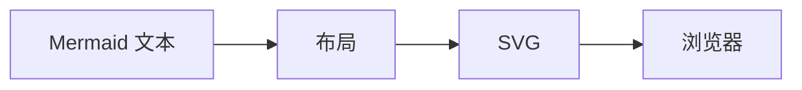
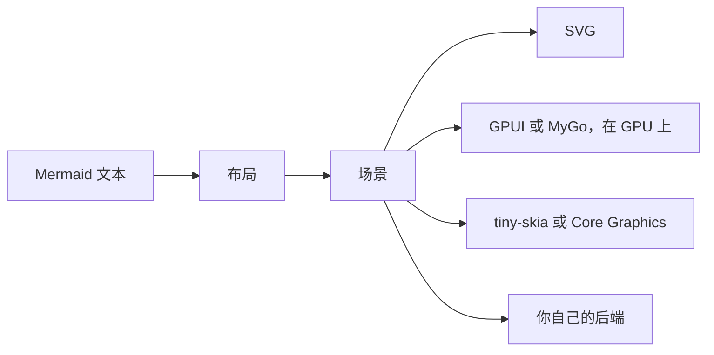

本页为使用 limu-rs 和 limu 的人概述它们的设计。完整的设计文档 [limu-rs 的](https://github.com/firede/limu-rs/blob/main/docs/design.md)和 [limu 的](https://github.com/firede/limu/blob/main/docs/design.md)是写给开发它们的人的。

limu-rs 和 limu 是同一个渲染器 [Pele](https://pele.run) 的两个移植版，一个用 Rust，一个用 Go。它们布局图表的方式相同，每个数值都精确到最后一位，区别在于程序调用它们的方式，以及各自附带的后端。

## 管线在哪里分叉 {#where-the-pipeline-branches}

Mermaid 和 Pele 布局一张图表后，把它写成 SVG，交给浏览器绘制。

limu 早一步停下，停在场景，管线在这里分叉，通向不同的后端。

用 SVG 渲染器时，应用只能拿到 SVG，不绘制 SVG 的原生应用就无从下手。场景是以数据表示的、已经布局好但尚未绘制的图表。应用可以用手头的任何工具绘制它，也可以向它查询什么东西在哪里。

## 各个阶段 {#the-stages}

图表依次经过三个阶段。

1. **解析**把文本读成模型。它处理 front matter 和指令，识别类型，再把正文交给该类型的解析器。
2. **布局**摆放模型的各个部分，生成场景，并用你提供的测量器测量文本。场景记录每个部分是什么、在哪里，但不记录它长什么样。
3. **后端**绘制场景，并从外观中取得颜色。

在 Rust 中，解析和布局在一个 crate 里，后端需要的内容在另一个 crate 里，所以后端从不需要编译解析器。需要自己依赖库的后端，各自是一个 crate。

| crate | 作用 |
| --- | --- |
| `limu` | 解析并布局图表，每种图表类型对应一个 feature。它还包含布局选项和角色的名称。 |
| `limu-scene` | 描述布局好的图表、其中的文本和样式，并包含所有后端共用的绘制逻辑和 SVG 后端。`limu` 以 `limu::scene` 的形式提供它。 |
| `limu-tiny-skia` | 用 tiny-skia 把场景绘制到位图中。 |
| `limu-coregraphics` | 在 Apple 平台上用 Core Graphics 绘制场景。 |
| `limu-gpui` | 在 GPUI 窗口中绘制场景。 |
| `limu-ascii` | 把场景绘制到终端的字符格中，用框线字符或只用 ASCII。 |

`limu` 和 `limu-scene` 只用到 Rust 标准库，以及可选 `serde` feature 背后的 `serde`。

在 Go 中，每个阶段都有自己的包。svg 包写出 SVG，limumygo 用 MyGo 绘制。

| 包 | 作用 |
| --- | --- |
| `limu` | 解析并布局图表。 |
| `diagram` | 读取每种图表都有的 front matter、指令和类型。每种类型在它下面有一个包，负责解析和布局该类型。 |
| `text` | 用你提供的测量器测量文本，并排布标签，处理换行、自动折行、强调和图标。 |
| `layout` | 包含布局选项。 |
| `scene` | 描述布局好的图表。 |
| `style` | 包含主题和按角色的覆盖。 |
| `svg` | 把场景渲染成 SVG。 |
| `limumygo` | 用 MyGo 绘制场景。它是一个独立的模块。 |

除 limumygo 外，每个包都只用到 Go 标准库。

## 布局与样式 {#layout-and-style}

凡是改变元素位置或大小的设置都属于布局，改变它们就要重新布局。这包括测量器及其字体、字号、可用宽度、留白、网格对齐、边的走向，以及甘特图的当前日期。其余都是样式，只在绘制场景时才应用，所以改变样式只需重绘。

这就是场景里没有颜色的原因。每个部分通过令牌引用颜色，比如表面色或边框色，并通过角色说明自己是什么，比如 `flowchart.node`。后端在主题和各角色的覆盖中查出实际的颜色。同一个场景无需重新布局，就能用浅色主题、深色主题或应用自己的外观来绘制。参见[主题](/theming)。

最后一张图保留了场景的几何形状，只替换了绘制方式。它的节点和边上的标签是 MyGo 的 Liquid Glass 玻璃面板，会在边缘处折射下方的内容。在浏览器中用 SVG 很难做到这一点。绘制这几张图的程序是 [limumygo/examples/pictures](https://github.com/firede/limu/tree/main/limumygo/examples/pictures)。

后端还可以更进一步，为自己的外观重新布局图表。[mygo-platinum](https://github.com/firede/mygo-platinum) 以 1990 年代末桌面系统的 Platinum 外观绘制 Mermaid。它用自己的点阵字体测量文本，所以方框的尺寸不同，并且逐像素绘制每条线和每个箭头。下面这张图由它的 [examples/diagrams](https://github.com/firede/mygo-platinum/tree/main/examples/diagrams) 绘制。

limu-rs 的终端后端对终端字符格也是这样处理的。它把每个字符都测量为一格，把场景对齐到字符格的网格，并用框线字符绘制线条。参见[终端](/terminal)。

## 编写后端 {#writing-a-backend}

在 Rust 中，各后端共用同一套绘制逻辑。后端实现 `limu::scene::Canvas`，负责填充和描边路径、排布文本片段和绘制图片，`limu::scene::draw` 按顺序遍历场景的图元。对每个图元，它先从外观中解析出颜色，再把图元的轮廓部分、边两端的标记、图片和标签交给画布，其中标签按字体样式切分成一个个片段。后端的钩子可以根据角色、形状、位置和走线，用别的方式绘制任意图元，其余的交给 painter。SVG 后端就是一个不到 600 行的画布实现，[API](/api#the-scene) 页面介绍了图元包含的内容。

后端按顺序遍历场景的图元，逐个绘制。它按照 `Paint` 的说明，用外观为该图元解析出的颜色（`style.Look.Resolve`），填充和描边图元的 `Parts`。接着绘制边两端的标记（`Marker.Outline`）、图元的图片和标签，标签每一行的每一段文字都以各自的字体样式排布在 `At` 周围。有自己外观的后端也可以根据 `Role`、`Shape`、`Box` 和 `Route` 自行绘制图元。svg 包是一个完整的后端，大约 700 行，[API](/api#the-scene) 页面介绍了图元包含的内容。

## 移植自 Pele {#ported-from-pele}

limu 的大部分代码逐个函数移植自 [Pele](https://pele.run)，即 Obsidian 团队开发的 Mermaid 渲染器。两个移植版都保留了 Pele 的名称，只按 Rust 和 Go 各自的大小写惯例书写，所以每个代码库都可以和 Pele 对照阅读。limu-rs 也是从 Pele 移植的，而不是从 limu 移植的。两者都对应 Pele 1.13.0。

它们的测试逐个数值地把输出与 Pele 的输出对照。一个名为 oracle 的工具用 Node 运行 Pele 的 TypeScript 源码，处理十万多张图表，这些图表来自 Pele 的测试和文档以及它们的变体，并把 Pele 的输出保存为 fixture。limu 的 oracle 是 limu 的一部分。limu-rs 从 [pele-oracle](https://github.com/firede/pele-oracle) 的发布版下载 fixture，pele-oracle 由 limu 的 oracle 发展而来。测试与这些 fixture 对照，哪怕某个数值只有最后一位不同，也算移植的 bug。测试在 amd64 和 arm64 上都会运行。

为了与 Pele 精确到最后一位，凡是影响测量或摆放的地方，两个移植版都保留了 JavaScript 的行为。字符串按 UTF-16 码元计数，空白和大小写遵循 JavaScript，`Math.round` 对 .5 的取舍方式相同，三角函数和 JSON 解析遵循 V8。乘积先舍入，再加到和里，与 JavaScript 一致，否则 Go 在 arm64 上会把两步融合成一次舍入。文本的测量方式与 Pele 在没有字体时相同，用的是一张 Arial 字符宽度表。

与 Pele 一致是验证移植版的手段，本身并不是目标。在 Mermaid 把图表交给外部库处理的地方，Pele 常常使用自己的布局，limu 跟随 Pele。参见[兼容性](/compatibility)。

limu-rs 沿用 limu 对事物的叫法，除非有理由改变。它在实现上与 limu 不同的地方，设计文档逐条列出了改动及其原因。大部分改动在场景和后端中。少数会影响到程序，比如泳道图有自己的角色，以及甘特图默认按 UTC 读取日期，除非程序指定了其他时区。
