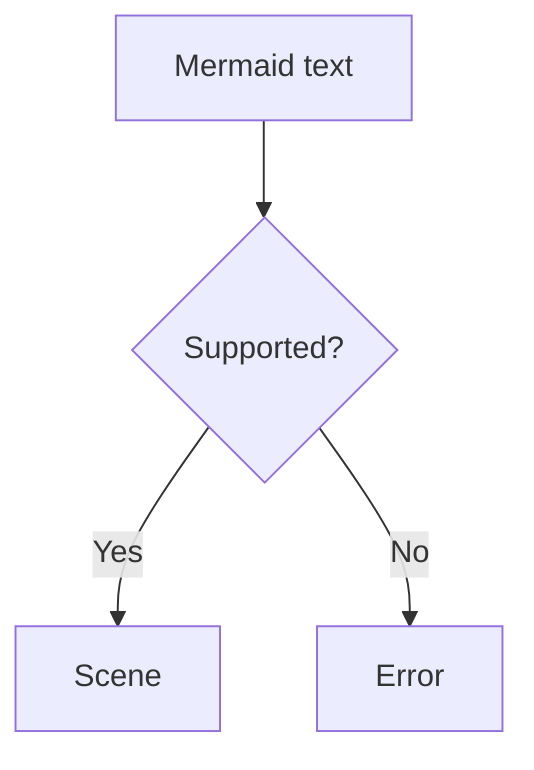

limu-ascii crate 把 limu 的场景绘制成文本，排在与终端字符格同样大小的网格中。线条用 Unicode 框线字符绘制，在只支持 ASCII 的终端中则用 ASCII 绘制。它可以在命令行工具、终端 UI，或其他任何需要以纯文本呈现图表的地方显示图表。

limu-rs 还很年轻，API 会在 0.x 的版本中改动。

## 安装 {#installing}

limu-ascii 是一个独立的 crate，这样 limu 和 limu-scene 就只依赖 Rust 标准库。它依赖 unicode-width，用来计算一个字符占几格。两个 crate 都要添加。

```shell
cargo add limu limu-ascii
```

## 把图表绘制成文本 {#drawing-a-diagram-as-text}

图表先按字符格布局，再绘制到字符格中。`limu_ascii::render` 返回文本，每行字符格对应一行文本，行尾没有空格。

```rust
use limu_ascii::{Cells, Options};

let cells = Cells::default();
let layout = limu::layout::Options {
    measurer: &cells,
    font_size: cells.font_size(),
    snap: Some(cells.grid()),
    max_width: 80.0 * cells.width,
    direction_breakpoint: f64::INFINITY,
    ..Default::default()
};
let scene = limu::layout(src, &layout)?;
print!("{}", limu_ascii::render(&scene, &Options::default())?);
```

对于下面的流程图，它会打印出下面的文本。



```text
      ╭──────────────╮
      │ Mermaid text │
      ╰───────┬──────╯
              │
       ┌──────▼─────┐
       < Supported? >
       └────┬──┬────┘
     ┌──────┘  └───────┐
     │                 │
    Yes               No
     │                 │
╭────▼──╮         ╭────▼──╮
│ Scene │         │ Error │
╰───────╯         ╰───────╯
```

[Rust Playground](/playground/rust) 可以把任何图表这样显示成终端文本。

## 按字符格布局 {#laying-out-for-cells}

布局没有专门针对字符格的模式，用它的几个选项就能为字符格做好设置。

- `measurer` 设为 `Cells`，它按文本在终端中所占的格数来测量。无论字号和字体样式如何，每个字符都占一格宽。
- `font_size` 设为 `cells.font_size()`，在这个字号下，一行文字正好一格高。行高是文字的 1.5 倍，所以字号是格高的三分之二。
- `snap` 设为 `cells.grid()`，让场景中的每个点都落在字符格的网格上。
- `max_width` 设为终端的宽度，即列数乘以 `cells.width`。把 `direction_breakpoint` 设为无穷大后，横向排列的图表放不下时，只要纵向排列更窄，就会改为纵向排列。

`Cells` 默认宽 6 个单位、高 12 个单位，与终端字符格的形状大致相同，文本按字号 8 布局。limu 在文本周围和形状内部留出的空间以像素给出，不随文本缩放，所以换算成字符格大约是一行。`Options.cells` 要使用布局场景时的同一组字符格。

给定 30 列时，从左到右书写的流程图 `text[Mermaid text] --> layout[Layout] --> scene[Scene]` 会改为纵向排列。给定 80 列时，它保持横向排列，如[字符](#characters)一节所示。

```text
╭──────────────╮
│ Mermaid text │
╰───────┬──────╯
        │
   ╭────▼───╮
   │ Layout │
   ╰────┬───╯
        │
    ╭───▼───╮
    │ Scene │
    ╰───────╯
```

图表的宽度由布局决定。大多数图表能放进给定的宽度，但有些无法画得更窄，这时不会为了适应宽度而截断或换行。

## 字符 {#characters}

`Options.charset` 选择绘制线条所用的字符。默认的 `Charset::Unicode` 用框线字符和 Unicode 箭头绘制。几条线在同一格相交时，会合成一个字符，比如“┬”或“┼”。`Charset::Ascii` 用“-”“|”“+”和字母表示箭头，用于只支持这些字符的终端和字体。

```rust
use limu_ascii::{Charset, Options};

let o = Options {
    charset: Charset::Ascii,
    ..Options::default()
};
```

横向排列的流程图用 ASCII 绘制，效果如下。

```text
+--------------+ +--------+ +-------+
| Mermaid text +-> Layout +-> Scene |
+--------------+ +--------+ +-------+
```

## 紧凑绘制 {#compact-drawing}

limu 按像素绘制的需要在元素之间留出空间。换算成字符格，这些空间就成了好几行、好几列，而文本图表通常只留一行或一列。所以 limu-ascii 在绘制之后把它们去掉，`Options.compact` 默认开启这一行为。只有竖线穿过的连续几行，以及只有横线穿过的连续几列，都会缩减为一行或一列，线条随之变短，所以不会断开。图表四周的空行和空列会被裁掉，每个节点的方框也会收紧到文本周围。块图和矩形树图保留原样的方框，因为它们的尺寸代表列数和数值。

在 `Options` 中设置 `compact: false` 后，每一格都保持场景给出的位置，如下面的流程图。

```text
 ╭─────────────────╮       ╭───────────╮       ╭──────────╮
 │  Mermaid text   ├───────▶  Layout   ├───────▶  Scene   │
 │                 │       │           │       │          │
 ╰─────────────────╯       ╰───────────╯       ╰──────────╯
```

## 不绘制的图表 {#diagrams-it-doesnt-draw}

有些图表的含义体现在位置和尺寸上，精细程度超出了字符格的表现能力。它们是饼图、XY 图、雷达图、桑基图、甘特图和数据包图。在 Git 图和树视图中，线条挨得太近，在字符格中无法区分。把这 8 种图表画成字符会误导读者，所以 `render` 对它们返回 `Unsupported` 错误。错误的 `diagram` 字段保存类型名，错误信息是“a pie diagram can't be drawn as text”。

`limu_ascii::supports` 接收图表类型的名称，即 `DiagramType::name` 返回的名称，判断 limu-ascii 能否绘制该类型。要在布局之前判断，先解析图表。

```rust
let diagram = limu::parse(src, &limu::ParseOptions::default())?;
if limu_ascii::supports(diagram.diagram_type().name()) {
    let scene = diagram.layout(&layout)?;
    print!("{}", limu_ascii::render(&scene, &limu_ascii::Options::default())?);
} else {
    // 换一种方式绘制，或者说明这里无法显示。
}
```

## 中文、日文和韩文 {#chinese-japanese-and-korean}

`Cells` 按终端的方式计算每个字符所占的格数。东亚文字的字符占两格，组合用的附加符号不占格，宽度取决于终端区域设置的字符占一格。布局按这些格数为文本留出空间，所以宽字符文本也能放进方框。

```text
╭──────╮ ╭──────╮ ╭──────╮
│ 开始 ├─▶ 检查 ├─▶ 完成 │
╰──────╯ ╰──────╯ ╰──────╯
```

框线字符和箭头都属于宽度取决于区域设置的字符。有些终端在东亚区域设置下把它们显示为两格宽，这会让图形错位，这时请改用 ASCII 绘制。

## 字符格无法表现的内容 {#what-cells-cant-show}

字符格没有颜色、填充和图片，所以 limu-ascii 不接收外观、字体、图标和图片。填充只会遮住它覆盖的内容，而且只在不透明的地方遮住，所以韦恩图中各个集合的轮廓会彼此透出来。节点中的图片，比如图标，会被省略。

边用横线和竖线绘制，和文本中画树形结构的方式一样，因为逐格描出的曲线很难看清。轮廓弯曲或倾斜的节点，比如体育场形或菱形，画成它所在的方框，弯曲处用圆角，尖角处用尖的侧边。小到无法在字符格中画出轮廓的形状，画成一个点，三角形则画成箭头，端点标记画成箭头或类似的符号。实体关系的两端写成双方的数量，比如“0..*”，因为鸦爪符号画在字符格中看起来像箭头。

标签最后排布，每行文字占一行字符格，每一行都完整排布。文字可以穿过竖线，但不会穿过横线或其他文字。没有空间时它会挪一行，仍然没有空间时，会为它插入一行。旋转 30 度或以上的标签，比如坐标轴标题，改为横排。
