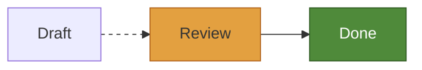
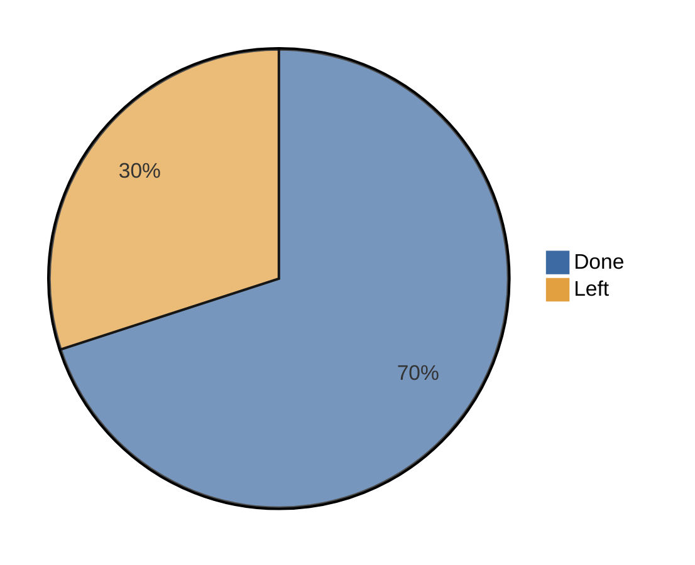

场景里没有颜色。每个部分通过令牌（token）引用颜色，比如表面色或边框色，由后端在绘制时解析。因此修改样式只需重绘图表，不必重新布局。

样式可以在三个层次上控制，每一层都比上一层控制得更细。

1. **主题**设定少量颜色和尺寸，所有图表都由它们绘制。
2. **覆盖**在主题之上修改某个角色的样式，比如 `flowchart.node`。
3. **自定义绘制**替换后端绘制某个部分的方式。

前两层组成外观 `rust:limu::scene::style::Look` `go:style.Look`，把它传给后端即可。

```rust
use limu::roles::flowchart;
use limu::scene::style::{Look, Paint, Style, Theme};
use limu::scene::svg;

let mut look = Look::new(Theme::KOHU_DARK);
look.overrides.insert(
    flowchart::NODE.into(),
    Style { fill: Some(Paint::ACCENT), text: Some(Paint::BG), ..Default::default() },
);
look.overrides.insert(
    flowchart::EDGE.into(),
    Style { dash: Some(vec![3.0, 4.0]), ..Default::default() },
);
let out = svg::render(&scene, &svg::Options { look, ..Default::default() });
```

```go
look := style.Look{
	Theme: style.KohuDark(),
	Overrides: style.Overrides{
		"flowchart.node": {Fill: style.Accent, Text: style.Bg},
		"flowchart.edge": {Dash: style.Dashes(3, 4)},
	},
}
out := svg.Render(sc, &svg.Options{Look: look})
```

字体和字号会改变元素的位置，所以它们属于[布局](/api#layout)，不属于样式。

## 主题 {#themes}

limu 自带三个主题。Kohu 和 Kohu dark，即 `rust:Theme::KOHU` `rust:Theme::KOHU_DARK` `go:style.Kohu()` `go:style.KohuDark()`，是 limu 自己的浅色和深色主题，用的是本站的配色。Pele 的浅色主题 `rust:Theme::PELE` `go:style.Default()` 是没有指定主题的外观所用的主题。

| 令牌 | 用途 | Kohu | Kohu dark | Pele |
| --- | --- | --- | --- | --- |
| `rust:bg` `go:Bg` | 背景，也用在线条上的标签背后 | `#f1f6f5` | `#0c1618` | `#ffffff` |
| `rust:fg` `go:Fg` | 文本 | `#0f262a` | `#d0dddc` | `#1f1f1f` |
| `rust:muted` `go:Muted` | 次要文本，比如分组标题 | `#536f72` | `#7f989b` | `#6e6e6e` |
| `rust:line` `go:Line` | 边和其他线条 | `#23393d` | `#b4c7c7` | `#1f1f1f` |
| `rust:surface` `go:Surface` | 形状的内部 | `#e5eeec` | `#142428` | `#f3f3f3` |
| `rust:surface_alt` `go:SurfaceAlt` | 分组和高亮形状的内部 | `#d6e4e2` | `#1b2f34` | `#e6e6e6` |
| `rust:border` `go:Border` | 形状的轮廓 | `#76939a` | `#557176` | `#8a8a8a` |
| `rust:accent` `go:Accent` | 图表要突出的部分 | `#a92e4a` | `#ee8494` | `#5b7bd5` |
| `rust:critical` `go:Critical` | 图表标为关键的部分，比如甘特图中的关键任务 | `#b0611a` | `#e3a040` | `#e45756` |

每个主题还有八个系列色。图表用它们绘制扇区、柱形和折线，Git 图和思维导图用它们绘制分支。系列超过八个时，从第一个颜色重新开始。在代码中，`rust:Paint::series(0)` `go:style.Series(0)` 是第一个系列色。

| 系列 | Kohu | Kohu dark | Pele |
| --- | --- | --- | --- |
| 1 | `#4f8a3a` | `#8cbf6a` | `#4c78a8` |
| 2 | `#b5435c` | `#e37d90` | `#f58518` |
| 3 | `#23817d` | `#5cbcb3` | `#54a24b` |
| 4 | `#a8761c` | `#d9a748` | `#e45756` |
| 5 | `#3d6aa3` | `#78a3d9` | `#72b7b2` |
| 6 | `#7b5aa0` | `#ad92d1` | `#eeca3b` |
| 7 | `#c0668a` | `#e693b3` | `#b279a2` |
| 8 | `#7d6a3f` | `#b9a272` | `#9d755d` |

三个主题的圆角半径都是 4（`rust:radius` `go:Radius`），线宽都是 1（`rust:stroke_width` `go:StrokeWidth`）。

要自定义主题，就填写主题的每一种颜色。如果只想改几种颜色，先复制一个现有主题。

```rust
use limu::scene::style::{Color, Look, Theme};

let mut theme = Theme::KOHU;
theme.accent = Color::hex("#3d6aa3");
let look = Look::new(theme);
```

```go
th := *style.Kohu()
th.Accent = style.Hex("#3d6aa3")
look := style.Look{Theme: &th}
```

SVG 后端把主题颜色写成 CSS 变量，所以页面无需重新渲染图表，就能切换颜色，比如在页面的浅色和深色主题之间切换。参见 [SVG](/svg#theme-variables)。

## 覆盖 {#overrides}

覆盖把角色映射到样式 `rust:limu::scene::style::Style` `go:style.Style`。样式中没有设置的项，沿用下一层的值。

| 字段 | 设置的内容 |
| --- | --- |
| `rust:fill, stroke, text` `go:Fill, Stroke, Text` | 内部、轮廓和线条、文本各自的着色。 |
| `rust:fill_opacity, stroke_opacity, opacity` `go:FillOpacity, StrokeOpacity, Opacity` | 填充、描边和整个部分的不透明度。 |
| `rust:stroke_width` `go:StrokeWidth` | 轮廓和线条的宽度。 |
| `rust:radius` `go:Radius` | 使用主题圆角的方框的圆角半径。 |
| `rust:dash` `go:Dash` | 线条的虚线样式，比如 `rust:vec![3.0, 4.0]` `go:style.Dashes(3, 4)`，或实线 `rust:vec![]` `go:style.Solid`。 |
| `rust:cap, join` `go:Cap, Join` | 线条端点和拐角的形状，与 SVG 的 `stroke-linecap` 和 `stroke-linejoin` 相同。 |
| `rust:halo, halo_width` `go:Halo, HaloWidth` | 文本周围的光晕，避免下方的线条贴到文字上。 |

着色可以是主题颜色，比如 `rust:Paint::SURFACE` `go:style.Surface`、`rust:Paint::ACCENT` `go:style.Accent` 或 `rust:Paint::series(2)` `go:style.Series(2)`，也可以是自定义颜色，比如 `rust:Paint::own(Color::hex("#3d6aa3"))` `go:style.Of(style.Hex("#3d6aa3"))`，或者是什么都不画的 `rust:Paint::NONE` `go:style.None`。`rust:Paint::with_opacity` `go:Paint.Alpha` 让着色带上透明度。在 Go 中，尺寸用 `style.N` 设置，比如 `StrokeWidth: style.N(2)`。在 Rust 中，每个字段都是 `Option`，比如 `stroke_width: Some(2.0)`。

样式按以下顺序层叠，优先级从低到高。最先是主题的尺寸，即圆角半径和线宽，然后是图表自身为该部分给出的样式，即这类图表为它指定的主题颜色，然后是你为它的角色设置的覆盖，最后是图表作者在文本中写的样式。

### 角色 {#roles}

角色由图表名和部分名用点连接而成，比如 `flowchart.node`、`sequence.actor` 或 `pie.slice`。每个角色都有一个常量，比如 `rust:limu::roles::flowchart::NODE` `go:flowchart.RoleNode`。SVG 后端会把角色写进类名，比如 `limu-flowchart-node`。在 [Playground](/playground) 中，状态栏会显示指针下方元素的角色。

在 Rust 中，泳道图有自己的角色，比如 `swimlane.node`，程序可以把它和流程图分开设置样式。在 Go 中，泳道图沿用流程图的角色，所以 `flowchart.node` 的覆盖也作用于泳道图。

## 自定义绘制 {#custom-drawing}

每个后端都接受一个函数，用来代替默认方式绘制图元。在 Rust 中，这个函数会收到后端的 painter，它的 `item` 按默认方式绘制图元。在 Go 中，它会收到 `next`，作用相同。这样，函数可以把大多数图元原样交给默认方式绘制。它也可以逐个绘制默认的各个部分，即轮廓、标记、图片和标签。下面的例子换了一种方式绘制流程图的判断菱形，并保留默认的标签。

```rust
let o = svg::Options { look, ..Default::default() };
let out = svg::render_with(&scene, &o, |p, it, s| {
    if it.shape.as_ref().map(|shape| shape.as_str()) != Some("diam") {
        p.item(it, s);
        return;
    }
    // 用 p.canvas().raw 在图元的 bounds 内写入菱形的 SVG 代码。
    p.label(it, s);
});
```

```go
out := svg.Render(sc, &svg.Options{
	Look: look,
	Draw: func(w *svg.Writer, it *scene.Item, s style.Style, next func()) {
		if it.Shape != "diam" {
			next()
			return
		}
		// 用 w.Raw 在图元的 Box 内写入菱形的 SVG 代码。
		w.Label(it, s)
	},
})
```

有自己外观的后端可以根据每个图元的角色、形状、位置，以及边的走线来绘制它，完全不用场景中的轮廓。每个后端用各自的工具绘制，所以这个函数的签名因后端而异。参见 [SVG](/svg#custom-drawing)，以及各个原生后端的页面。

## 图表中的样式 {#styles-in-the-diagram}

图表作者可以在文本里用 `classDef`、`class`、`:::` 和 `style` 设置各部分的样式，还可以用 `linkStyle` 设置流程图中边的样式。



limu 读取 `fill`、`stroke`、`color`、各项不透明度、`stroke-width`、`stroke-dasharray`、`stroke-linecap`、`stroke-linejoin`、`rx` 和 `ry`。它还读取字重、斜体和字号，这些会改变文本的尺寸，所以交给布局处理。其他属性，以及任何可能引用图表之外内容的值，都会被忽略。

作者的样式优先于你的覆盖。它们的颜色是固定的，不随主题变化。

作者为某个部分设置了填充、却没有设置文本颜色时，文本会用主题的前景色或背景色绘制，取两者中与填充对比更强的那个，这与 Pele 相同。作者填充的分组中的边和标签也是如此，比如子图、块或时序图的方框。穿过这类分组边界的边，会在下面先画一条衬底线，即一条更宽、背景色的线，让边在填充上也清晰可见。衬底线是一个有自己角色的图元，比如 `block.casing`。图表原本画成半透明的分组，比如块图中的复合块，在作者设置填充后会画成不透明。

### 调色板 {#palettes}

图表的文本还可以用 Mermaid 的调色板主题变量设置系列色，写在 front matter 或 `init` 指令中。饼图读取 `pie1` 到 `pie8`，Git 图读取 `git0` 到 `git7`，时间线、雷达图和矩形树图读取 `cScale0` 到 `cScale7`，思维导图读取 `cScale1` 到 `cScale8`。韦恩图读取 `venn1` 到 `venn8`，并重复使用已设置的那些。XY 图读取 `xyChart.plotColorPalette` 中的列表，同样会重复使用。



limu 把调色板当作作者的颜色，与 `style` 行一样处理。用调色板中已设置的系列绘制的部分会采用调色板的颜色，优先于你的覆盖，其上的标签则取主题前景色和背景色中对比更强的那个。limu 能读取十六进制颜色、颜色名、`rgb()`、`hsl()`、`transparent` 和 `currentColor`。它自己无法求值的颜色，比如 `var()`、`color-mix()` 或 `oklch()`，会让该系列保留主题的颜色。

### 只用主题绘制 {#drawing-with-the-theme-alone}

当页面的外观由设计令牌决定时，图表的文本不应该能改变它。在外观上设置 `rust:theme_only` `go:ThemeOnly`，后端就只用主题和你的覆盖来绘制。它会忽略作者的样式（包括调色板）、为了在作者的填充上显得清楚而为文本和边挑选的颜色，以及衬底线。

```rust
let mut look = Look::new(Theme::KOHU);
look.theme_only = true;
```

```go
look := style.Look{Theme: style.Kohu(), ThemeOnly: true}
```

`rust:theme_only` `go:ThemeOnly` 只改变绘制方式。作者设置的、会改变尺寸的内容仍然有效，因为布局已经测量过它们。这包括文本的字重、斜体和字号，以及象限图中点的半径。
