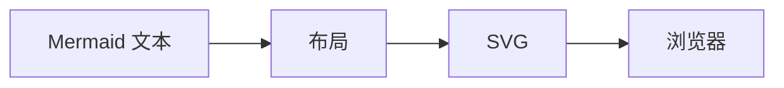
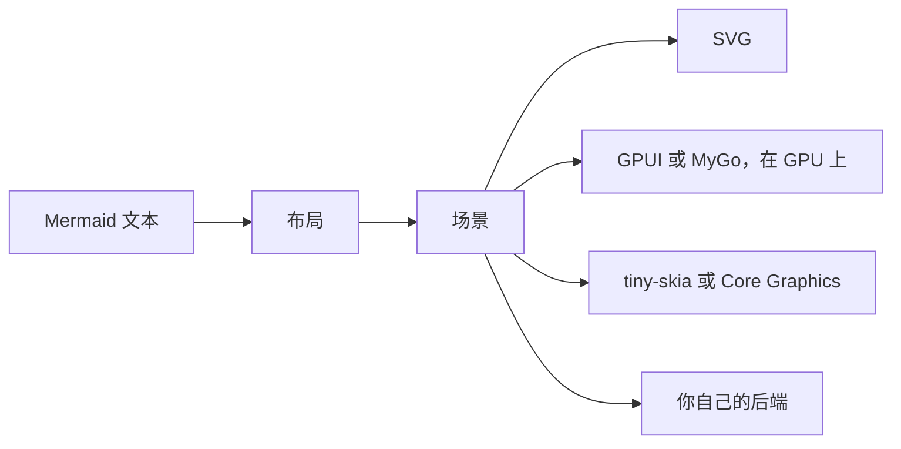

limu 是一个用 Rust 和 Go 编写的图表布局引擎。它读取 Mermaid，把绘制交给你的程序。

## 工作方式 {#how-it-works}

Mermaid 和 Pele（limu 移植自这个 Mermaid 渲染器）布局一张图表后，把它写成 SVG，交给浏览器绘制。



limu 早一步停下，停在场景（scene）。场景是以数据表示的、已经布局好的图表。它记录每个部分是什么、在哪里，但不记录它长什么样。之后由后端来绘制。limu 提供的后端有在 GPU 上绘制的 GPUI 和 MyGo，绘制到位图的 tiny-skia 和 Core Graphics，绘制到终端字符格的后端，以及 SVG。你也可以自己写一个。



场景里没有颜色，所以只需布局一次，就能用任意多种方式绘制。切换主题只需重绘，后端也可以按自己的方式绘制每个部分。


后端还可以更进一步，为自己的外观重新布局图表。[mygo-platinum](https://github.com/firede/mygo-platinum) 就这样为 Platinum 桌面绘制图表。


应用还可以向场景查询指针下方是哪个部分。

## 在应用中使用 limu {#in-your-app}

### Rust

#### GPUI

```shell
cargo add limu limu-gpui
```

limu-gpui 在 GPUI 窗口中绘制场景，和窗口的其余部分一起在 GPU 上绘制，并用 GPUI 的文本系统测量文本。场景能告诉你指针下方是哪个部分。

```rust
// 用窗口的文本系统测量文本，字体与绘制时相同。
let measurer = TextMeasurer::new(window, Fonts::default());
let layout = limu::layout::Options { measurer: &measurer, ..Default::default() };
let scene = limu::layout(src, &layout)?;

// 在 canvas 的绘制闭包中绘制场景，并查看某一点上是哪个部分。
let o = Options { look: Look::new(Theme::KOHU_DARK), ..Options::default() };
paint(&scene, &o, bounds.origin, 1.0, window, cx);
if let Some(i) = scene.item_at(at, 4.0) {
    println!("clicked {} {:?}", scene.items[i].role.as_str(), scene.items[i].id);
}
```

#### tiny-skia

```shell
cargo add limu limu-tiny-skia
```

limu-tiny-skia 把场景绘制到位图中，使用程序自带的字体文件，不需要 GPU，也不依赖系统库。布局时要用绘制时的同一套字体。

```rust
let fonts = Fonts::new(std::fs::read("Inter-Regular.ttf")?)?;
let layout = limu::layout::Options { measurer: &fonts, ..Default::default() };
let scene = limu::layout(src, &layout)?;
let o = Options {
    look: Look::new(Theme::KOHU),
    fonts: Some(&fonts),
    scale: 2.0,
    ..Options::default()
};
let pixmap = limu_tiny_skia::render(&scene, &o).ok_or("too large to draw")?;
pixmap.save_png("diagram.png")?;
```

#### 终端

```shell
cargo add limu limu-ascii
```

limu-ascii 按终端的字符格布局图表，用框线字符绘制，也可以只用 ASCII。

```rust
let cells = Cells::default();
let layout = limu::layout::Options {
    measurer: &cells,
    font_size: cells.font_size(),
    snap: Some(cells.grid()),
    max_width: 80.0 * cells.width,
    direction_breakpoint: f64::INFINITY,
    ..Default::default()
};
let scene = limu::layout(src, &layout)?;
print!("{}", limu_ascii::render(&scene, &Options::default())?);
```

#### SVG

```shell
cargo add limu
```

limu::scene::svg 把场景写成 SVG，颜色保留为 CSS 变量，页面可以重新设置样式。limu 只用到 Rust 标准库。

```rust
let scene = limu::layout(src, &Default::default())?;
let out = svg::render(&scene, &svg::Options {
    look: Look::new(Theme::KOHU),
    ..Default::default()
});
```

### Go

#### MyGo

```shell
go get github.com/firede/limu/limumygo
```

limumygo 用 MyGo 的原生 UI 在 GPU 上绘制场景，并告诉你指针下方是哪个部分。布局时要用绘制时的同一套字体。

```go
fonts := limumygo.DefaultFonts
sc, err := limu.Layout(src, &layout.Options{Measurer: fonts})
if err != nil {
	return err
}

// 在视图中绘制图表，并查看点击了哪个部分。
w := limumygo.View(c, sc, &limumygo.Options{
	Look:  style.Look{Theme: style.KohuDark()},
	Fonts: fonts,
})
if it := w.Clicked(); it != nil {
	fmt.Println("clicked", it.Role, it.ID)
}
```

#### SVG

```shell
go get github.com/firede/limu
```

svg 包把场景写成 SVG，颜色保留为 CSS 变量，页面可以重新设置样式。limu 和 svg 包只用到 Go 标准库。

```go
sc, err := limu.Layout(src, nil)
if err != nil {
	return err
}
out := svg.Render(sc, &svg.Options{Look: style.Look{Theme: style.Kohu()}})
```

## 继续阅读 {#explore}

- [示例](/examples.md)展示 limu 支持的每种图表，用它的各个主题绘制。
- [快速上手](/getting-started.md)布局第一张图表，并渲染成 SVG。
- [主题](/theming.md)介绍如何用主题和覆盖修改颜色，或自己绘制各个部分。

## limu 与 Pele {#limu-and-pele}

limu 逐个函数移植自 [Pele](https://pele.run)，后者是 [Obsidian](https://obsidian.md) 团队开发的小巧、快速的 Mermaid 渲染器。共有两个移植版，Rust 版 limu-rs 和 Go 版 limu。两者的测试都逐个数值检查布局是否与 Pele 一致。两者都以 MIT 许可证开源，见 [Rust 版](https://github.com/firede/limu-rs)和 [Go 版](https://github.com/firede/limu)。

Pele 得名于夏威夷的火山女神。Limu 在夏威夷语中指海里的藻类。本站的配色取自 limu kohu，一种生长在潮池里的红藻。
